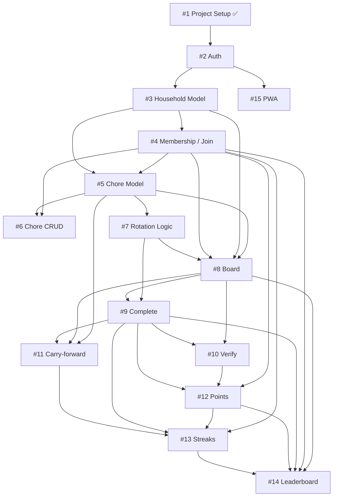

# Backlog Grooming — Shared Household Chores Tool

All 15 issues groomed. Each issue file lives alongside this index in the artifacts directory.

---

## Status Overview

| # | Issue | Status | Depends On |
|---|---|---|---|
| 1 | Project setup with a passing test | ✅ Done | — |
| 2 | User registration and login | ✅ Done | #1 |
| 3 | Household model and creation | ✅ Done | #2 |
| 4 | Join a household via invite code | ✅ Done | #2, #3 |
| 5 | Chore model | ✅ Done | #3, #4 |
| 6 | Chore management — create, edit, delete | ✅ Done | #2, #3, #4, #5 |
| 7 | Chore rotation logic | ✅ Done | #5 |
| 8 | Shared household board | ✅ Done | #3, #4, #5, #7 |
| 9 | Mark a chore as complete | ✅ Done | #5, #7, #8 |
| 10 | Verify chore completion | ✅ Done | #8, #9 |
| 11 | Carry-forward pending chores | ✅ Done | #5, #8, #9 |
| 12 | Points tracking | ✅ Done | #4, #9, #10 |
| 13 | Streaks | ✅ Done | #4, #9, #11, #12 |
| 14 | Leaderboard | ✅ Done | #4, #8, #9, #12, #13 |
| 15 | PWA — manifest and service worker | ✅ Done | #2 (base template) |

---

## Dependency Graph

---

## 🚨 Cross-Cutting Open Decisions

These must be resolved **before** the relevant issues are picked up. Resolving them here avoids mid-sprint rework.

### 1. Can a user belong to multiple households? *(blocks #4, #5, #8)*
- **Option A — One household per user:** `unique_together = [("user",)]` on `Membership`. Simpler.
- **Option B — Multiple households:** Only `unique_together = [("household", "user")]`. Requires a household-switcher in the UI.
- 👉 **Recommended for homework: Option A.**

### 2. Does household creation auto-create a Membership row for the owner? *(blocks #3, #4)*
- **Option A (recommended):** Create a `Membership` row for the owner in the `create_household` view or via `post_save` signal. Keeps member queries uniform.
- **Option B:** Handle the owner as a special case in every query (`owner OR member`).

### 3. `invite_code` format *(blocks #3)*
- `secrets.token_urlsafe(8)` → ~11 URL-safe characters (e.g. `Xk3mNpQrLvA`)
- Shorter human-typeable code: 6 uppercase letters (`ABCDEF`) — friendlier to type on mobile.
- 👉 **Decide before writing the model test.**

### 4. `rotation_members` — per-chore streak or per-member streak? *(blocks #13)*
- The `current_streak` field on `Membership` is a single number per member.
- If a member is assigned to multiple chores and misses one, is the whole streak reset?
- **Option A (per-member):** One streak for all chores. Missing any resets it.
- **Option B (per-chore):** Requires a `ChoreStreak` through-model.
- 👉 **Decide before starting #13.**

### 5. "Current period" definition *(blocks #9, #11)*
- A `ChoreCompletion` belongs to the period `[next_due_date, next_due_date + 1 period)`.
- This definition must be used consistently in #8 (board status), #9 (duplicate prevention), and #11 (carry-forward check).
- 👉 **Extract a shared helper function. Agree on the definition before writing any of #8, #9, or #11.**

### 6. Overdue rotation — same member or next? *(blocks #7, #8)*
- When a chore is overdue by N periods, `current_responsible_index` returns which member?
- Is it the member for the Nth period (the one who *missed* it) or the (N+1)th (the *next* one)?
- 👉 **Decide and document in the rotation function's docstring (#7).**

### 7. Points bonus rounding on small values *(blocks #12)*
- `floor(5 * 0.10) = 0` — a chore worth 5 points gives no verification bonus.
- Acceptable? Or should there be a minimum bonus of 1?
- 👉 **Confirm before writing #12 tests.**

### 8. "Completed chore count" on leaderboard — all or verified only? *(blocks #14)*
- Count all `ChoreCompletion` rows, or only `verified = True` ones?
- 👉 **Decide before writing the leaderboard query.**

---

## Individual Groomed Issues

- [Issue #1](file:///Users/pranabsarma18/.gemini/antigravity-cli/brain/4a2b17d2-82c7-48c9-96e6-dc0852420744/issue-01-groomed.md) — Project Setup ✅
- [Issue #2](file:///Users/pranabsarma18/.gemini/antigravity-cli/brain/4a2b17d2-82c7-48c9-96e6-dc0852420744/issue-02-groomed.md) — User Registration & Login
- [Issue #3](file:///Users/pranabsarma18/.gemini/antigravity-cli/brain/4a2b17d2-82c7-48c9-96e6-dc0852420744/issue-03-groomed.md) — Household Model & Creation
- [Issue #4](file:///Users/pranabsarma18/.gemini/antigravity-cli/brain/4a2b17d2-82c7-48c9-96e6-dc0852420744/issue-04-groomed.md) — Join via Invite Code
- [Issue #5](file:///Users/pranabsarma18/.gemini/antigravity-cli/brain/4a2b17d2-82c7-48c9-96e6-dc0852420744/issue-05-groomed.md) — Chore Model
- [Issue #6](file:///Users/pranabsarma18/.gemini/antigravity-cli/brain/4a2b17d2-82c7-48c9-96e6-dc0852420744/issue-06-groomed.md) — Chore CRUD (Owner Only)
- [Issue #7](file:///Users/pranabsarma18/.gemini/antigravity-cli/brain/4a2b17d2-82c7-48c9-96e6-dc0852420744/issue-07-groomed.md) — Rotation Logic
- [Issue #8](file:///Users/pranabsarma18/.gemini/antigravity-cli/brain/4a2b17d2-82c7-48c9-96e6-dc0852420744/issue-08-groomed.md) — Shared Board
- [Issue #9](file:///Users/pranabsarma18/.gemini/antigravity-cli/brain/4a2b17d2-82c7-48c9-96e6-dc0852420744/issue-09-groomed.md) — Mark Complete
- [Issue #10](file:///Users/pranabsarma18/.gemini/antigravity-cli/brain/4a2b17d2-82c7-48c9-96e6-dc0852420744/issue-10-groomed.md) — Verify Completion
- [Issue #11](file:///Users/pranabsarma18/.gemini/antigravity-cli/brain/4a2b17d2-82c7-48c9-96e6-dc0852420744/issue-11-groomed.md) — Carry-Forward Pending Chores
- [Issue #12](file:///Users/pranabsarma18/.gemini/antigravity-cli/brain/4a2b17d2-82c7-48c9-96e6-dc0852420744/issue-12-groomed.md) — Points Tracking
- [Issue #13](file:///Users/pranabsarma18/.gemini/antigravity-cli/brain/4a2b17d2-82c7-48c9-96e6-dc0852420744/issue-13-groomed.md) — Streaks
- [Issue #14](file:///Users/pranabsarma18/.gemini/antigravity-cli/brain/4a2b17d2-82c7-48c9-96e6-dc0852420744/issue-14-groomed.md) — Leaderboard
- [Issue #15](file:///Users/pranabsarma18/.gemini/antigravity-cli/brain/4a2b17d2-82c7-48c9-96e6-dc0852420744/issue-15-groomed.md) — PWA Manifest & Service Worker
